# 🎯 Python & Git 개념 퀴즈 게임

터미널에서 실행하는 4지선다 퀴즈 게임입니다.
Python 기초와 Git 명령어 개념을 문제로 풀며 복습할 수 있습니다.

---

# Part 1. 메인 요구사항

## 1. 프로젝트 개요

- 터미널(콘솔)에서 실행하는 객관식 퀴즈 게임
- 메뉴에서 번호를 선택해 **퀴즈 풀기 / 퀴즈 추가 / 퀴즈 목록 / 최고 점수 확인 / 종료** 기능 사용
- 퀴즈 데이터와 최고 점수는 `state.json`에 저장되어, 프로그램을 종료 후 다시 실행해도 유지됨
- 개발 환경: Python 3.10 이상, 외부 라이브러리 없이 표준 라이브러리만 사용

## 2. 실행 환경

- OS: Windows
- Python: 3.11.6
- Git: 2.56.1

## 3. 퀴즈 주제와 선정 이유

- **주제**: 이번 미션에서 학습하는 Python 기초 문법과 Git 명령어
- **문제 형식**: 개념이나 명령어에 대한 설명을 읽고, 이에 해당하는 개념을 고르는 4지선다
- **선정 이유**
  - 미션의 학습 목표(Python 기초, 클래스, 파일 입출력, Git)를 스스로 점검하기 위해
  - 직접 만든 프로그램을 학습 내용 복습용 시험 문제로 다시 활용하기 위해
- **구성**: 기본 퀴즈 8문제 + 퀴즈 추가 기능으로 1문제 추가 (총 9문제)

## 4. 실행 방법

### 요구 사항

- Python 3.10 이상
- 외부 라이브러리 설치 불필요

### 실행

```bash
git clone https://github.com/wjdalsrb129/E1-2_python-quiz-game.git
cd E1-2_python-quiz-game
python main.py
```

- Windows에서는 PowerShell 또는 VSCode 터미널에서 실행하는 것을 권장 (이모지 출력)
- `python` 명령이 없다면 `python3 main.py`로 실행

## 5. 기능 목록

| 메뉴 | 기능 | 설명 |
|---|---|---|
| 1 | 퀴즈 풀기 | 등록된 퀴즈를 순서대로 출제, 정답/오답과 정답 안내, 결과(맞힌 수·점수) 출력, 최고 점수 갱신 시 안내 |
| 2 | 퀴즈 추가 | 문제, 선택지 4개, 정답 번호를 입력받아 등록 후 즉시 저장 |
| 3 | 퀴즈 목록 | 등록된 퀴즈의 개수와 문제 목록 출력 (선택지·정답은 숨김) |
| 4 | 점수 확인 | 최고 점수와 당시 맞힌 문제 수 출력 |
| 5 | 종료 | 데이터 저장 후 종료 |

- 퀴즈가 0개일 때 풀기·목록 메뉴에서 안내 메시지 출력
- 아직 퀴즈를 푼 기록이 없을 때 점수 확인 메뉴에서 안내 메시지 출력
- 프로그램 시작 시 저장된 데이터를 불러오고, 불러온 퀴즈 개수와 최고 점수 안내

## 6. 파일 구조

```
E1-2_python-quiz-game/
├── main.py                # 프로그램 실행 진입점, Ctrl+C·EOF 안전 종료 처리
├── quiz.py                # Quiz 클래스 (퀴즈 1개를 표현)
├── quiz_game.py           # QuizGame 클래스 (게임 전체 관리)
├── default_quizzes.json   # 기본 퀴즈 원본 (읽기 전용)
├── state.json             # 퀴즈 목록·최고 점수 저장 파일
├── README.md
├── .gitignore
└── docs/
    └── screenshots/       # 실행 화면 캡처
```

## 7. 데이터 파일 설명

### state.json

- **경로**: 프로젝트 루트의 `state.json`
- **인코딩**: UTF-8
- **역할**: 퀴즈 목록과 최고 점수를 저장하여, 프로그램을 다시 실행해도 데이터가 유지되도록 함

#### 스키마

| 키 | 타입 | 설명 |
|---|---|---|
| `quizzes` | list | 퀴즈 목록 |
| `quizzes[].question` | str | 문제 |
| `quizzes[].choices` | list[str] | 선택지 4개 |
| `quizzes[].answer` | int | 정답 번호 (1~4) |
| `best_score` | int | 최고 점수 (0~100). 정답률 × 100을 사사오입 반올림한 정수 |
| `best_correct` | int | 최고 점수 기록 당시 맞힌 문제 수 |
| `best_total` | int | 최고 점수 기록 당시 전체 문제 수 (0이면 아직 기록 없음) |

#### 예시

```json
{
    "quizzes": [
        {
            "question": "변경한 파일을 다음 커밋에 포함하도록 스테이징 영역에 올리는 Git 명령어는?",
            "choices": ["commit", "add", "push", "init"],
            "answer": 2
        }
    ],
    "best_score": 75,
    "best_correct": 6,
    "best_total": 8
}
```

#### 스키마를 이렇게 설계한 이유

- **퀴즈를 객체(dict)의 리스트로 저장**: 퀴즈 1개 = Quiz 객체 1개와 1:1로 대응되어 `to_dict()` / `from_dict()`로 그대로 변환 가능
- **최고 점수를 점수·맞힌 수·전체 수로 나누어 저장**: 문제 수가 바뀌어도 점수(정답률)로 공정하게 비교하고, 화면에는 "N문제 중 M문제 정답"을 함께 표시하기 위함
- **최상위를 dict로 구성**: 이후 `history` 같은 필드를 추가해도 기존 구조가 깨지지 않음

#### Git 포함 여부

- `state.json`은 `.gitignore`에 넣지 않고 저장소에 포함
- 이유: 저장소를 clone한 사용자도 추가된 퀴즈가 포함된 상태로 바로 실행할 수 있도록 하기 위함
- 저장소에는 풀이 기록이 없는 초기 상태(퀴즈 9개, 최고 점수 0)로 커밋

### default_quizzes.json

- **경로**: 프로젝트 루트의 `default_quizzes.json`
- **역할**: 기본 퀴즈 8문제의 원본 데이터. 프로그램이 수정하지 않는 읽기 전용 파일
- **형식**: state.json의 `quizzes`와 동일한 구조
- **코드가 아닌 별도 파일로 분리한 이유**: 문제 내용(데이터)과 프로그램 로직(코드)을 분리하여, 코드를 수정하지 않고도 기본 문제를 바꿀 수 있도록 하기 위함

### 데이터 읽기/쓰기 흐름

| 시점 | 동작 | 메서드 |
|---|---|---|
| 프로그램 시작 | state.json 불러오기 (없으면 default_quizzes.json 사용) | `QuizGame.__init__()` → `load_state()` |
| 퀴즈 추가 직후 | 저장 | `add_quiz()` → `save_state()` |
| 최고 점수 갱신 직후 | 저장 | `play_quiz()` → `save_state()` |
| 5번 메뉴로 종료 | 저장 | `run()` → `save_state()` |
| Ctrl+C / EOF로 중단 | 저장 후 종료 | `main.py` → `save_state()` |

- 데이터가 바뀌는 순간 바로 저장하므로, 비정상 종료가 발생해도 그 직전까지의 데이터가 유지됨
- **저장 방식**: `state.json.tmp`에 먼저 쓴 뒤 `state.json`과 교체. 저장 도중 프로그램이 꺼져도 기존 state.json은 손상되지 않음

### 예외 상황 처리

- **state.json이 없는 경우(첫 실행)**: default_quizzes.json의 기본 퀴즈로 시작
- **state.json이 손상된 경우**: 손상된 파일을 `state.json.bak`으로 백업한 뒤, 안내 메시지 출력 후 기본 퀴즈로 복구
  - 손상 판단 기준: JSON 문법 오류, 필수 키 누락, 값 형식 오류(선택지가 4개가 아님, 정답 번호가 범위 밖 등)
- **state.json을 읽을 수 없는 경우(권한 문제 등)**: 기본 퀴즈로 시작하되 파일은 수정하지 않음
- **default_quizzes.json도 없거나 손상된 경우**: 안내 메시지 출력 후 퀴즈 0개로 시작 (퀴즈 추가 기능으로 등록 가능)

## 8. 클래스 설계

### Quiz (quiz.py)

퀴즈 1개의 데이터와, 그 데이터로 할 수 있는 일(출력, 정답 확인, 변환)을 담당

| 구분 | 이름 | 설명 |
|---|---|---|
| 상수 | `CHOICE_COUNT` | 선택지 개수 (4). 선택지 개수가 바뀌면 이 값만 수정 |
| 속성 | `question` | 문제 |
| 속성 | `choices` | 선택지 목록 |
| 속성 | `answer` | 정답 번호 (1~4) |
| 메서드 | `display()` | 문제와 선택지 출력 |
| 메서드 | `is_correct()` | 사용자 입력이 정답인지 확인 |
| 메서드 | `get_answer_text()` | 정답 번호에 해당하는 선택지 내용 반환 |
| 메서드 | `to_dict()` | 저장을 위해 dict로 변환 |
| 메서드 | `from_dict()` | 불러온 dict를 검증한 뒤 Quiz 객체 생성 |

### QuizGame (quiz_game.py)

퀴즈 목록과 최고 점수를 가지고 게임 전체 흐름을 관리. 메서드를 역할에 따라 5개 그룹으로 나눔

| 그룹 | 메서드 | 설명 |
|---|---|---|
| 1. 메뉴 진행 | `run()` | 메뉴 반복, 선택에 따라 기능 실행 |
| | `show_menu()` | 메뉴 출력 |
| 2. 퀴즈 기능 | `play_quiz()` | 퀴즈 풀기 전체 흐름 (출제 → 채점 → 기록 갱신 → 결과) |
| | `ask_question()` | 문제 1개 출제 및 정답 판정 |
| | `show_result()` | 결과 출력 |
| | `add_quiz()` | 퀴즈 추가 |
| | `list_quizzes()` | 퀴즈 목록 출력 |
| | `show_score()` | 최고 점수 출력 |
| 3. 점수 | `calculate_score()` | 점수 계산 (정답률 × 100, 사사오입) |
| | `update_best_score()` | 최고 점수 비교 및 갱신 |
| 4. 입력 처리 | `get_number_input()` | 숫자 입력 검증 (공백 제거, 빈 입력·문자·범위 밖 처리) |
| | `get_text_input()` | 문자 입력 검증 (공백 제거, 빈 입력 처리) |
| 5. 데이터 | `load_default_quizzes()` | default_quizzes.json 불러오기 |
| | `load_state()` | state.json 불러오기 (손상 시 백업 후 복구) |
| | `validate_best_record()` | 불러온 최고 점수 값 검증 |
| | `backup_broken_state()` | 손상된 state.json을 .bak으로 백업 |
| | `save_state()` | state.json 저장 (임시 파일에 쓴 뒤 교체) |

### 설계 기준

- **Quiz는 퀴즈 1개에 대한 것만 안다**: 문제 출력과 정답 판단은 Quiz가, 몇 번째 문제인지·몇 개 맞혔는지는 QuizGame이 관리
- **입력 처리는 한곳에서**: 메뉴, 정답, 퀴즈 추가 등 모든 입력이 `get_number_input()`, `get_text_input()`을 거치므로 검증 기준이 어디서나 동일
- **게임 진행과 저장의 분리**: 기능 메서드는 데이터를 바꾼 뒤 `save_state()`를 호출만 하고, 파일 형식·경로·오류 처리는 데이터 그룹 메서드가 전담
- **요구사항 변경 시 수정 위치가 한 곳이 되도록**: 채점 방식 변경 → `calculate_score()`, 선택지 개수 변경 → `CHOICE_COUNT`

### 화면 출력 형식

- 퀴즈 결과: `결과: 5문제 중 4문제 정답! (80점)`
- 최고 점수: `최고 점수: 80점 (5문제 중 4문제 정답)`

## 9. 예외 처리 정책

### 입력 처리

숫자 입력(메뉴 선택, 정답 입력, 정답 번호 등록)은 모두 `get_number_input()`으로 처리

| 입력 | 처리 |
|---|---|
| 앞뒤 공백 (예: ` 1 `) | 공백 제거 후 정상 처리 |
| 빈 입력 (Enter) | 안내 메시지 출력 후 재입력 |
| 숫자가 아닌 입력 (예: `abc`) | 안내 메시지 출력 후 재입력 |
| 범위 밖 숫자 (예: 메뉴 `9`, 정답 `0`) | 허용 범위 안내 후 재입력 |

문자 입력(문제, 선택지)은 `get_text_input()`으로 처리하며, 앞뒤 공백을 제거하고 빈 입력은 다시 입력받음

### 데이터 파일

7번 "예외 상황 처리" 참고 (파일 없음 / 손상 / 읽기 실패 / 기본 파일 문제)

### 프로그램 중단 (Ctrl+C, EOF)

- `main.py`에서 `game.run()` 전체를 `try/except`로 감싸 `KeyboardInterrupt`와 `EOFError`를 처리
- 입력 위치(메뉴, 풀이 중, 퀴즈 추가 중)와 관계없이 안내 메시지 출력 → 데이터 저장 → 정상 종료
- 퀴즈 추가 도중 중단하면 입력 중이던 퀴즈는 저장되지 않음 (반쯤 입력된 데이터가 남지 않도록)
- EOF 확인 방법: `echo 3 | python main.py` (목록 출력 후 입력이 끝나 EOF 발생)

## 10. Git 작업 기록

### 커밋 메시지 규칙

`타입: 변경 내용 요약` 형식으로, 무엇을 왜 바꿨는지 드러나게 작성

| 타입 | 의미 | 예시 |
|---|---|---|
| `Feat` | 새 기능 | `Feat: 퀴즈 추가 기능 구현 (문자 입력 검증 포함)` |
| `Fix` | 버그 수정, 동작 보완 | `Fix: Ctrl+C·EOF 입력 시 저장 후 안전 종료 처리` |
| `Refactor` | 동작 변화 없는 구조 개선 | `Refactor: QuizGame 메서드 역할별 정리 및 선택지 개수 상수화` |
| `Docs` | 문서, 스크린샷 | `Docs: 실행 화면 및 개발 환경 스크린샷 추가` |
| `Chore` | 설정, 데이터 파일 등 | `Chore: 퀴즈 9문제가 포함된 초기 state.json 추가` |

### 커밋 단위

- 기능 하나가 동작하는 단위로 커밋 (메뉴 → Quiz 클래스 → 기본 데이터 → 풀기 → 추가 → 목록 → 점수 → 구조 정리 → 저장 → 안전 종료)
- 코드 변경과 데이터 파일(state.json), 문서 변경은 별도 커밋으로 분리

### 브랜치 전략

- `main`: 항상 실행 가능한 상태 유지
- `feature/기능명`: 기능 개발용 브랜치. 개발과 테스트를 마친 뒤 main에 병합
- 병합 시 `git merge --no-ff`를 사용하여 병합 커밋을 남김 → 어떤 커밋들이 하나의 기능 단위였는지 이력에서 확인 가능

| 브랜치 | 작업 내용 | 병합 커밋 |
|---|---|---|
| `feature/play-quiz` | 퀴즈 출제·정답 판정, 결과 출력·점수 계산 | `Merge: 퀴즈 풀기 기능 (feature/play-quiz)` |

### Git 명령어 사용 기록

| 명령어 | 사용한 곳 |
|---|---|
| `init` | 프로젝트 폴더를 Git 저장소로 초기화 |
| `add` / `commit` | 기능 단위 커밋 |
| `push` | 커밋마다 GitHub 원격 저장소에 업로드 |
| `checkout` | `feature/play-quiz` 브랜치 생성·이동, main 복귀 |
| `clone` | clone/pull 실습 (아래 참고) |
| `pull` | clone/pull 실습 (아래 참고) |

### clone / pull 실습

미션 저장소를 별도 디렉터리에 clone한 뒤, 복제본에서 변경·push하고 기존 작업 디렉터리에서 pull로 가져오는 과정을 실습

| 순서 | 위치 | 명령어 | 내용 |
|---|---|---|---|
| 1 | `mkj/` | `git clone <저장소 URL>` | `E1-2_python-quiz-game/` 폴더로 복제 |
| 2 | `E1-2_python-quiz-game/` (복제본) | `git add` → `git commit` → `git push` | README에 이 섹션(clone/pull 실습 기록) 추가 |
| 3 | `python-quiz-game/` (기존 작업 폴더) | `git pull` | 복제본에서 push한 커밋을 가져옴 |
| 4 | `python-quiz-game/` | `git log --oneline` | 가져온 커밋과 README 변경이 반영되었는지 확인 |

- 이 섹션은 복제본에서 작성되어, pull을 통해 기존 작업 폴더에 반영된 내용


#### clone 실행 화면
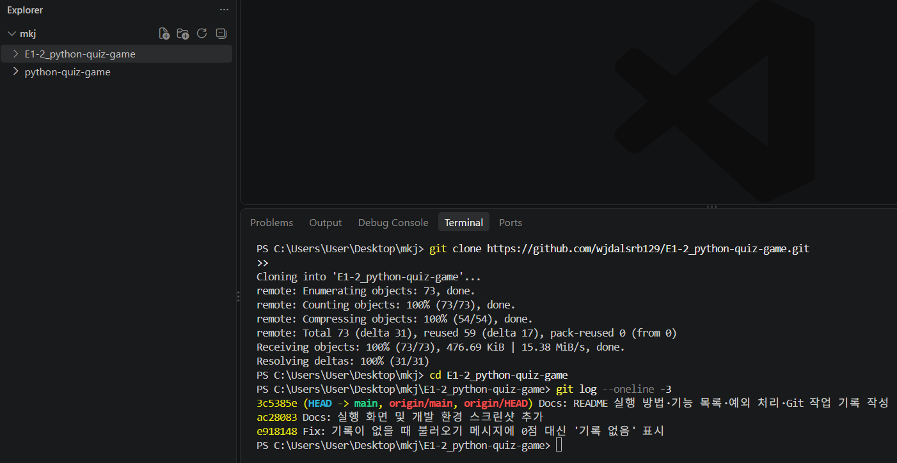

#### pull 실행 화면
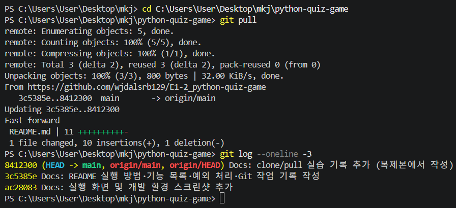

### 커밋 그래프

> 작성 예정

## 11. 실행 화면

### 개발 환경
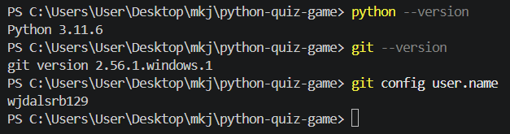

### 메뉴
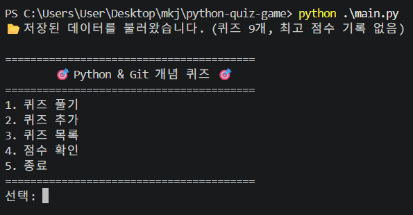

### 퀴즈 풀기
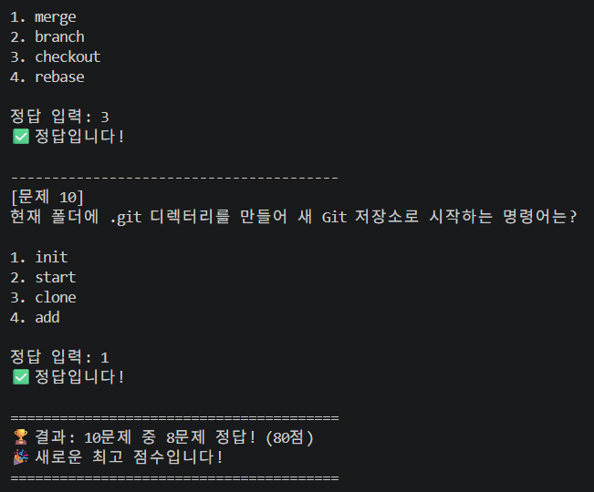

### 퀴즈 추가
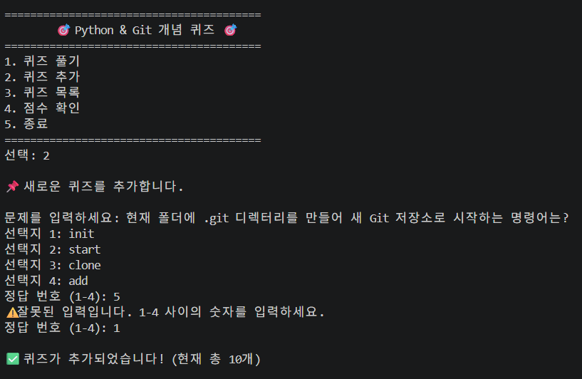

### 퀴즈 목록
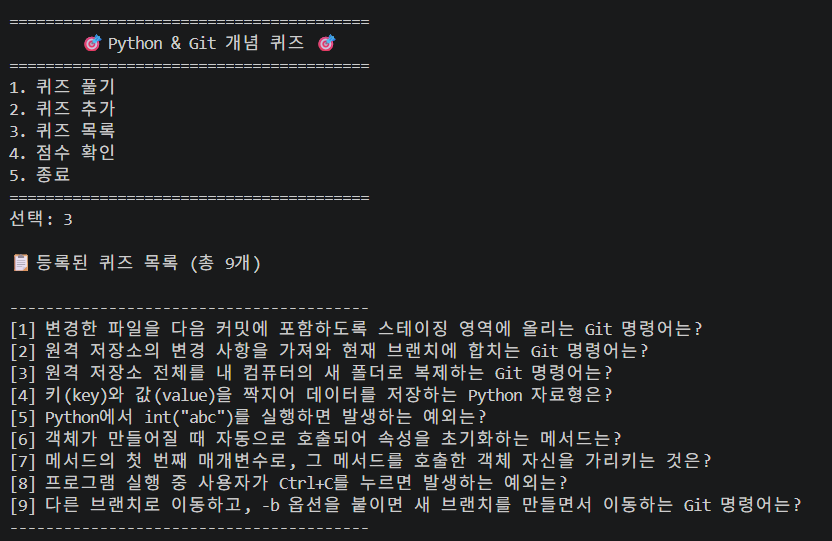

### 점수 확인
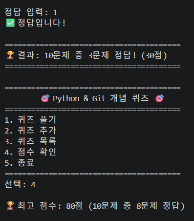

### 잘못된 입력 처리
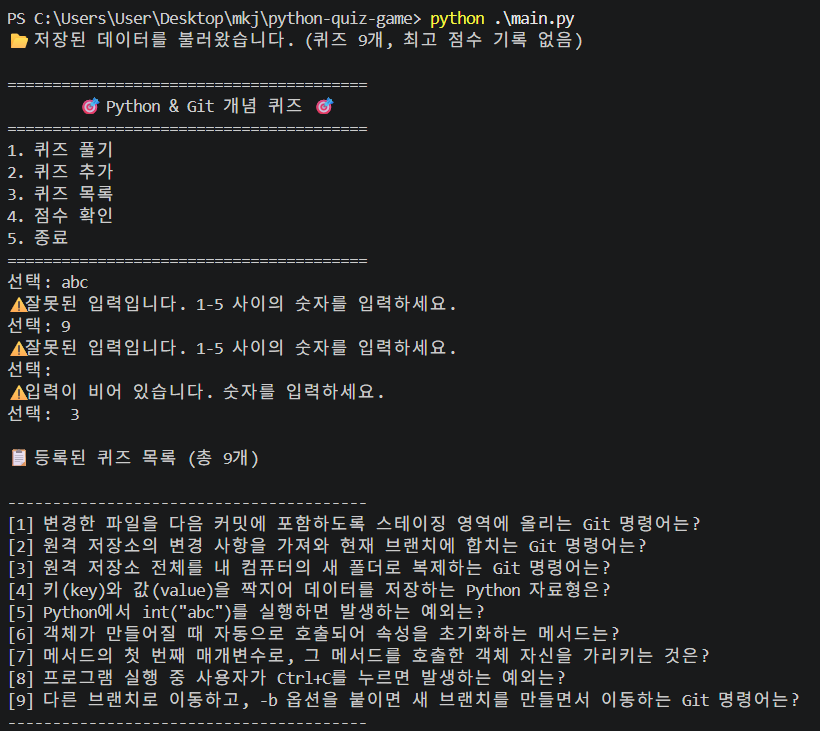

### 재실행 후 데이터 유지
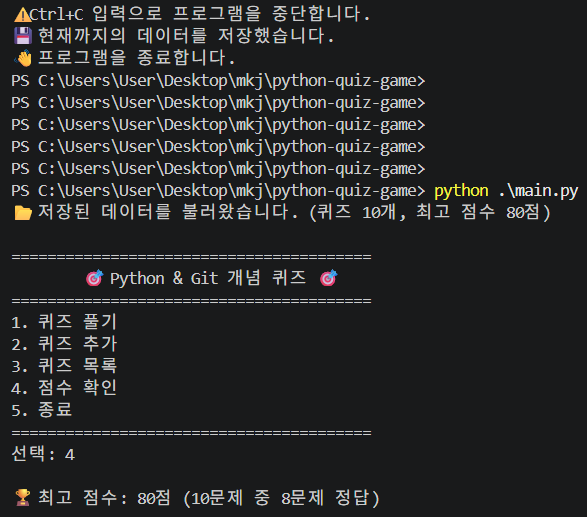

### Ctrl+C 안전 종료
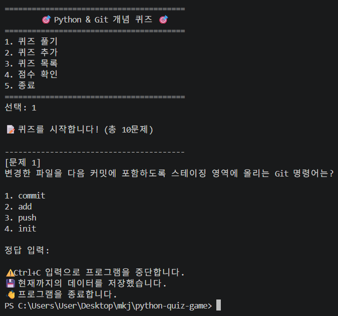

### 손상된 state.json 복구
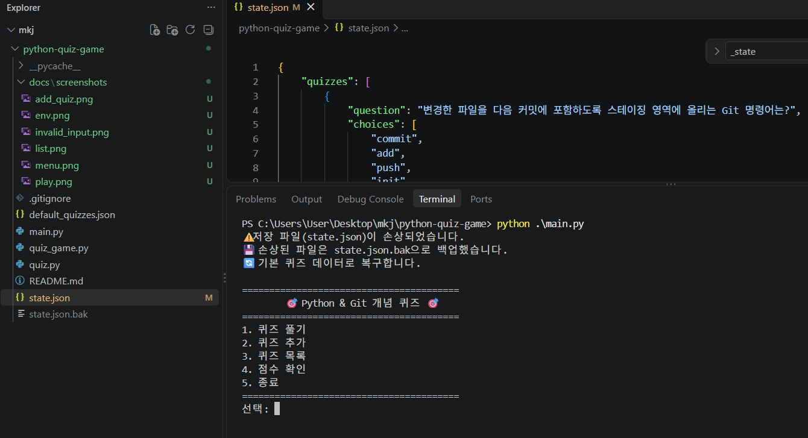

---

# Part 2. 보너스 과제

> 작성 예정

---

# Part 3. 개념 정리

> 작성 예정